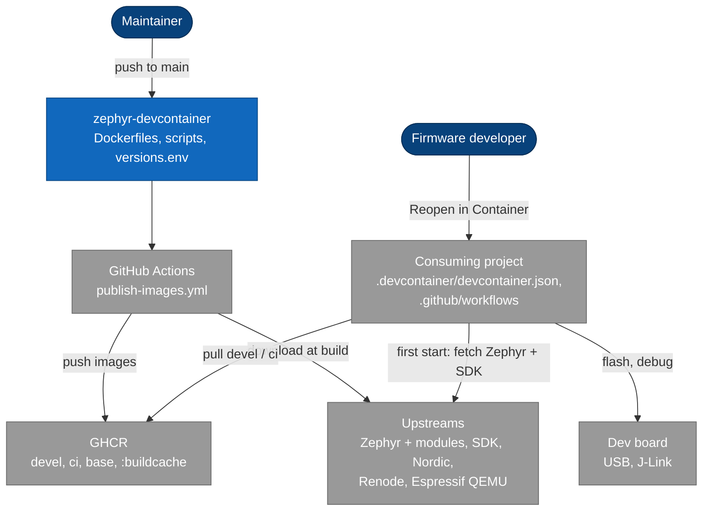
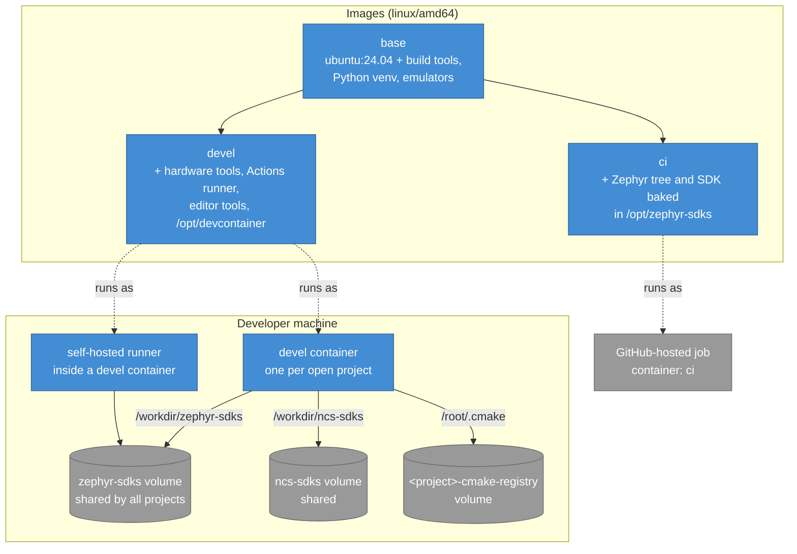
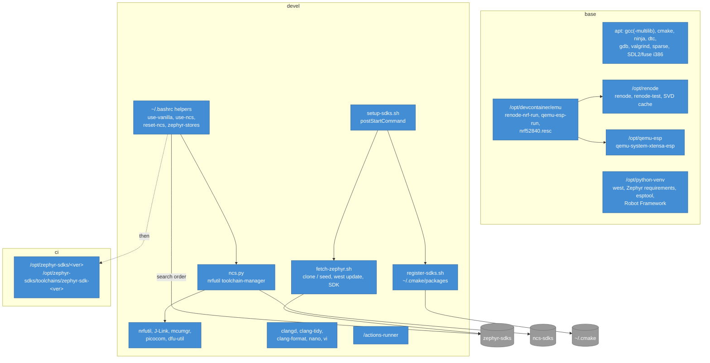
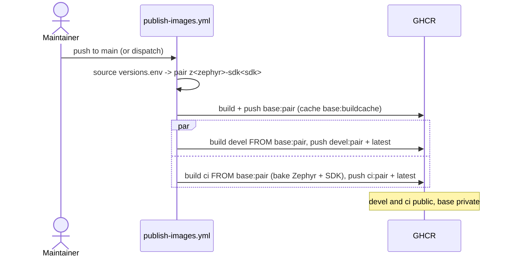
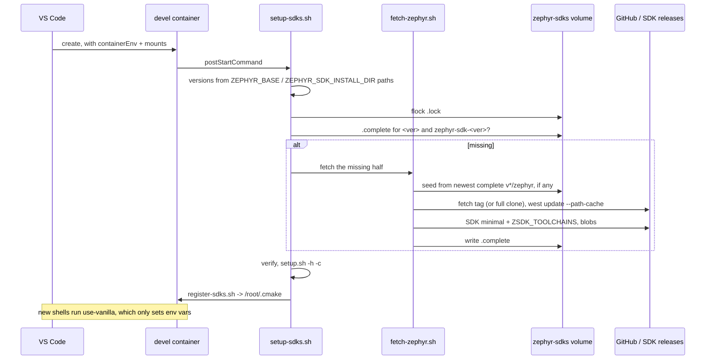
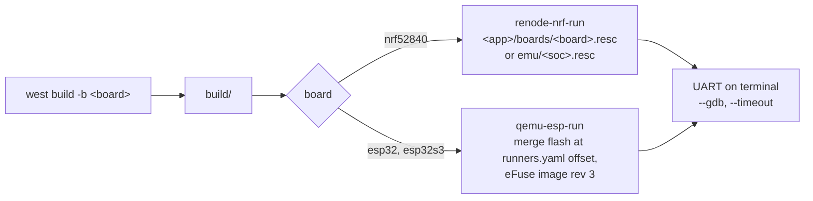

# Stage 1: Current, living document

- **Period:** 2026-09-11 – now (last updated 2026-10-28)
- **Code:** this repository, `HEAD`
- **Shaped by:** ADR [0001](../adr/0001-build-from-ubuntu.md) – [0020](../adr/0020-mcumgr-from-source.md);
  RFC [0001](../rfc/0001-image-split.md) – [0005](../rfc/0005-devel-build-hygiene.md)

> Update this file when the architecture changes; see [Updating](README.md#updating).

## Summary

This repository publishes two images to GHCR, both built from a shared `base`. `devel` is what a
project's `devcontainer.json` runs: it carries the tools and scripts, and fetches the Zephyr tree
and SDK the project asks for into a volume shared by every project on the machine. `ci` has one
Zephyr/SDK pair baked in for GitHub-hosted jobs. Flashing runs on a self-hosted runner inside a
devel container. Both images can run firmware in Renode or Espressif QEMU.

## Context (C4 level 1)

## Containers (C4 level 2): images, volumes, runners

| Image | Consumer | Has the SDK? | Size |
|---|---|---|---|
| `base` | `ci` and `devel` builds only (private) | no | ~3.2 GB |
| `devel` | `devcontainer.json`, self-hosted runner | no, fetched into `zephyr-sdks` | ~4.8 GB |
| `ci` | `container:` of GitHub-hosted jobs | yes, the pair in `versions.env` | ~14 GB |

Configuration flows in two separate directions, and they never meet:

- **This repository's `versions.env`** sets what `ci` bakes, the `ZSDK_TOOLCHAINS` union and the
  image tag (ADR [0007](../adr/0007-tag-by-zephyr-sdk-pair.md), [0009](../adr/0009-ci-toolchains-union.md)).
- **A consumer's `containerEnv`** sets what `devel` fetches at start
  (ADR [0004](../adr/0004-containerenv-only-config.md)).

## Components (C4 level 3)

| Component | File |
|---|---|
| Build tools, venv, emulators, launcher install and checks | `Dockerfile.base` |
| Emulator launchers and machine descriptions | `scripts/emu/` |
| Baked Zephyr/SDK | `Dockerfile.ci` |
| Downloads stage, mcumgr stage, hardware/editor tools, shell helpers | `Dockerfile.devel` |
| First-start install, verify, register | `scripts/setup-sdks.sh`, `fetch-zephyr.sh`, `register-sdks.sh` |
| nRF Connect SDK install and environment | `scripts/ncs.py` |
| Image build and publish | `build.sh`, `.github/workflows/publish-images.yml`, `.devcontainer/devcontainer.json` |
| Emulator smoke test | `test/app/`, `test/emu-smoke.sh` |

## Key flow: publishing

## Key flow: first start of a devel container

## Key flow: running firmware in an emulator

## Decisions

| Area | ADR |
|---|---|
| Image layout and contents | [0001](../adr/0001-build-from-ubuntu.md), [0002](../adr/0002-ci-and-devel-siblings.md), [0008](../adr/0008-hardware-tools-in-devel.md), [0013](../adr/0013-linux-amd64-only.md), [0017](../adr/0017-emulators-in-base.md), [0020](../adr/0020-mcumgr-from-source.md) |
| Where the SDK lives and how it is configured | [0003](../adr/0003-sdk-in-shared-volume.md), [0004](../adr/0004-containerenv-only-config.md), [0009](../adr/0009-ci-toolchains-union.md), [0012](../adr/0012-one-venv-newest-zephyr.md) |
| Runtime scripts | [0005](../adr/0005-scripts-in-image.md), [0010](../adr/0010-sentinels-and-store-lock.md), [0011](../adr/0011-shell-helpers-env-only.md), [0014](../adr/0014-cmake-registry-volume.md) |
| Fetching | [0015](../adr/0015-git-http1-and-retries.md), [0016](../adr/0016-seeded-fetch.md) |
| Building and publishing | [0006](../adr/0006-registry-cache-and-pushed-base.md), [0007](../adr/0007-tag-by-zephyr-sdk-pair.md), [0018](../adr/0018-lf-line-endings.md), [0019](../adr/0019-vendor-downloads-stage.md) |

## Known limits

- `linux/amd64` only; on Apple Silicon emulated and without USB.
- `build.sh`, `.devcontainer/devcontainer.json` and `publish-images.yml` build the same images
  and are kept in step by hand.
- Republishing an unchanged tag is invisible to consumers who already pulled it.
- The publish workflow does not run `test/emu-smoke.sh`; it is run by hand in the devel container.
- Emulation limits (no radio in QEMU, partial Renode nRF52840 model, no MCUboot in
  `qemu-esp-run`, no ESP32-C3/C6) are in RFC [0004](../rfc/0004-emulation.md).
