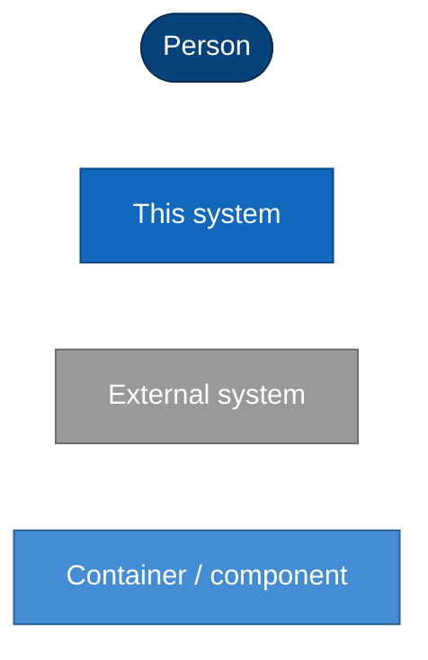

# Architecture

How the images, volumes, scripts and pipelines fit together. One document per **architecture
stage**: a stage starts when the shape of the system changes (which images exist, where the SDK
lives, how consumers use it), not with every RFC.

| Stage | Period | Tag | In one line |
|---|---|---|---|
| [1. Current](01-current.md) | 2026-09-11 – now | `z4.4.0-sdk1.0.1` | base + sibling ci/devel on GHCR; SDK in a shared volume; emulators in base |

Stage 1 is the **living document**: update it when the architecture changes. When the shape of
the system changes, freeze it and add `02-<name>.md` with a "What changed from stage 1" section
and a row above.

## What each stage contains

1. **Context (C4 level 1)**: the images, who uses them and the systems around them.
2. **Containers (C4 level 2)**: images, volumes and what runs where.
3. **Components (C4 level 3)**: what is inside each image.
4. **Key flows**: publishing, a devcontainer's first start, emulation.
5. **Decisions** that shaped it (ADRs) and known limits.

## Diagrams

Mermaid, so they render on GitHub and diff like code. C4 levels are drawn as flowcharts:

## Updating

- **A change that alters a diagram** (new tool in an image, new volume, new launcher): update
  stage 1's diagrams and its decisions table, linking the RFC/ADR.
- **A change in the shape of the system**: freeze stage 1, add stage 2.
- **Fixes** that leave the diagrams alone: commit messages, and an RFC if they need evidence.
